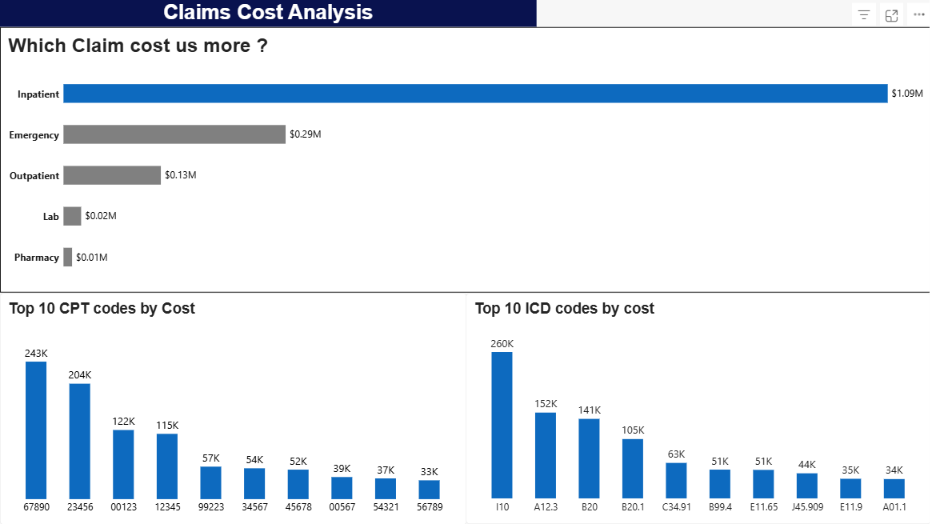
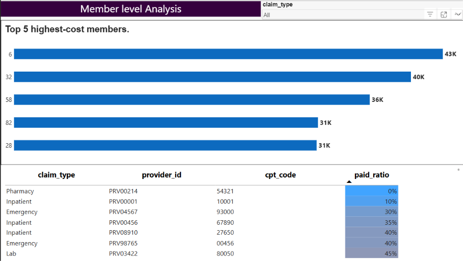

# 🏥 Healthcare Claims Cost & Utilization Analysis (Power BI)

An interactive, multi-page **Power BI Report** designed to analyze medical claim expenditures, identify high-cost medical drivers (Claim Types, CPT procedure codes, and ICD diagnosis codes), evaluate member-level cost concentrations, and assess insurance reimbursement ratios (`Paid Ratio`).

> **Toolstack:** Exclusively built using **Microsoft Power BI Desktop** (Power Query for ETL, Data Modeling/DAX, and Power BI Visualizations).

---

## 📌 Table of Contents

* [Overview](#overview)
* [Power BI Report Architecture & Pages](#power-bi-report-architecture--pages)
  * [Page 1: Claims Cost Analysis](#page-1-claims-cost-analysis)
  * [Page 2: Member level Analysis](#page-2-member-level-analysis)
* [Key Analytical Insights & Findings](#key-analytical-insights--findings)
* [Core Business Questions Answered](#core-business-questions-answered)
* [Data Transformation & Power Query Workflow](#data-transformation--power-query-workflow)
* [Project File Structure](#project-file-structure)
* [How to Open & View the Report](#how-to-open--view-the-report)

---

## 🔎 Overview

Managing healthcare expenses requires clear visibility into high-utilization sectors, diagnoses driving heavy spending, and individual member utilization patterns. 

This Power BI project provides executive-level decision support by analyzing healthcare claims data across five key sectors: **Inpatient, Emergency, Outpatient, Lab, and Pharmacy**.

---

## 📊 Power BI Report Architecture & Pages

The Power BI report (`Project Dashboard.pbix`) consists of **two main dashboard pages**:

 

### Page 1: Claims Cost Analysis
Focuses on overall claim spending across service categories, high-impact clinical procedure codes (CPT), and primary diagnoses (ICD).


#### Visual Elements & Insights:
1. **Which Claim cost us more? (Horizontal Bar Chart):**
   * Highlights overall spending by claim category.
   * **Inpatient** services dominate total cost at **\$1.09M**, followed by **Emergency** (\$0.29M) and **Outpatient** (\$0.13M). Lab (\$0.02M) and Pharmacy (\$0.01M) make up a negligible fraction.
2. **Top 10 CPT codes by Cost (Column Chart):**
   * Procedure code **`67890`** (Acute Inpatient Hospital Stay) is the single highest procedure driver at **\$243K**, followed by `23456` at **\$204K**.
3. **Top 10 ICD codes by cost (Column Chart):**
   * Primary diagnosis code **`I10`** (Essential/Primary Hypertension) leads all clinical conditions with **\$260K** in total incurred costs.

---
 

### Page 2: Member level Analysis
Focuses on individual patient/member financial metrics, top-utilizer concentration, and claim payout ratios across healthcare providers.


#### Visual Elements & Insights:
1. **Top 5 Highest-Cost Members (Horizontal Bar Chart):**
   * Displays the top 5 cost-concentrated individual members:
     * **Member 6:** \$43K
     * **Member 32:** \$40K
     * **Member 58:** \$36K
     * **Member 82:** \$31K
     * **Member 28:** \$31K
2. **Paid Ratio Analysis Table:**
   * Features interactive Slicers (`claim_type`) to drill down into provider-level reimbursement rates (`paid_ratio`), analyzing how billed charges translate into paid claims.

---

## ❓ Core Business Questions Answered

### Q1: Which claim types are the most expensive?
**Answer:**
**Inpatient** care represents the vast majority of expenditure at **\$1.09M**, compared to Emergency (\$0.29M) and Outpatient (\$0.13M).

### Q2: Which CPT and ICD codes drive the highest spending?
**Answer:**
* **Top CPT Procedure:** Code `67890` (\$243K)
* **Top ICD Diagnosis:** Code `I10` (\$260K)

$$
\text{Top 3 CPT Procedures: } 67890\ (\$243\text{K}) > 23456\ (\$204\text{K}) > 00123\ (\$122\text{K})
$$

$$
\text{Top 3 ICD Diagnoses: } \text{I10}\ (\$260\text{K}) > \text{A12.3}\ (\$152\text{K}) > \text{B20}\ (\$141\text{K})
$$

### Q3: Which members account for the largest share of total costs?
**Answer:**
Using DAX / Power Query calculated member cost shares:

$$
\text{Member Share \%} = \left( \frac{\text{Member Total Cost}}{\sum \text{All Members Cost}} \right) \times 100
$$

Member **ID 6** is the highest single cost driver, responsible for **2.79%** of overall plan spending (**\$43,300**).

### Q4: How do billed amounts compare to paid amounts?
**Answer:**
Analysis of the `paid_ratio` matrix shows that most medical claim categories display a high **Paid Ratio ($> 80\%$)**, meaning the insurer reimburses over 80% of total billed provider charges.

---

## 🛠 Data Transformation & Power Query Workflow

This project was engineered **100% inside Power BI**:

1. **Power Query ETL:**
   * Data extraction and cleaning from `claims.csv` and `members.csv`.
   * Data type standardization (Currency, Text, Integer keys).
   * Column transformations and custom `Paid Ratio` metrics.
2. **Data Modeling & DAX:**
   * Star-schema/Relational model linking `members` to `claims` via `member_id`.
   * Calculated measures for aggregating spending, percentages, and top-N rankings.
3. **Data Visualization:**
   * Custom theme formatting, dynamic filters/slicers, and responsive bar/column charts.

---

## 📁 Project File Structure

```
.
├── Project Dashboard.pbix   # Primary Power BI Report file
├── Claims_Cost_2.png        # Screenshot of Page 1: Claims Cost Analysis
├── Member_Analysis_2.png    # Screenshot of Page 2: Member level Analysis
├── claims.csv               # Medical claims transactional data source
├── members.csv              # Member demographic table source
├── Project Q and A.pdf      # Detailed project Q&A executive summary
└── README.md                # Project documentation
```

---

## 🚀 How to Open & View the Report

1. **Power BI Desktop:**
   * Double-click `Project Dashboard.pbix` to launch the interactive dashboard in Microsoft Power BI Desktop.
   * Interact with visual cross-filtering and drill-through slicers on both pages (**Claims Cost Analysis** and **Member level Analysis**).
2. **Data Files:**
   * The underlying data tables (`claims.csv` and `members.csv`) are imported directly into the Power BI data model via Power Query.